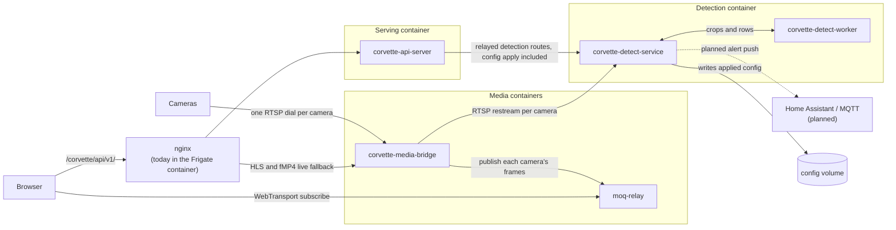
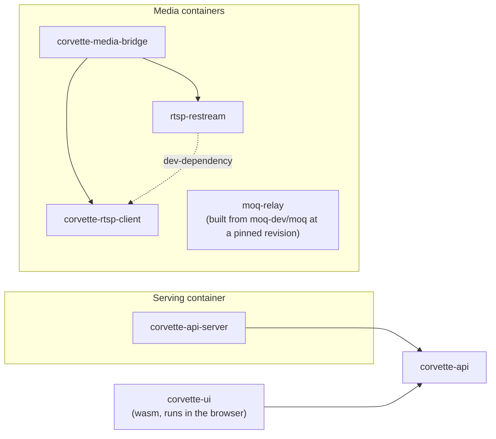
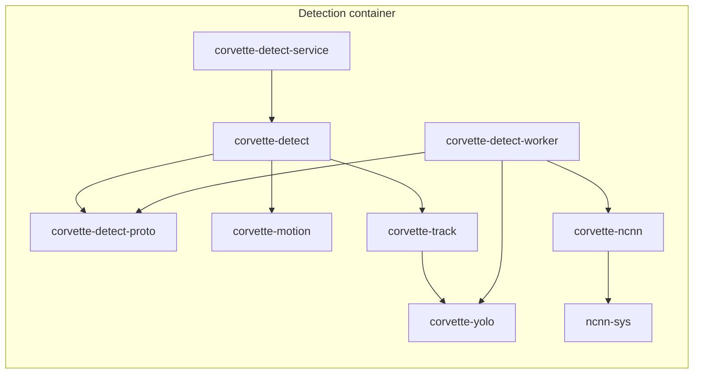
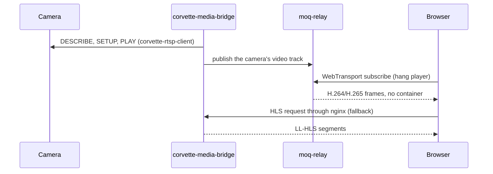
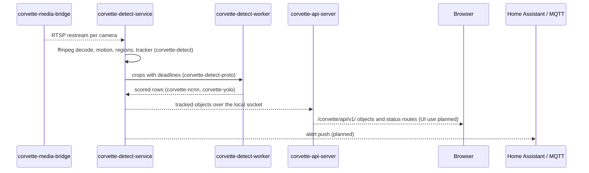

# Architecture

Corvette replaces Frigate one boundary at a time: a Leptos UI first, then a Rust service behind the
same nginx router, followed by detection and recording. The end state is a Rust NVR using
ncnn/Vulkan for inference. Planned work and current status live in [GitHub issue #1][roadmap].

The repository today is one Cargo workspace of eighteen crates. Their runtime binaries ship in one
image (`docker/Dockerfile.corvette`) and run as three container groups: serving, media and detection.

This document describes the target architecture Corvette is converging on. The replacement is
incremental (see below), so a section can describe a component ahead of the issue that ships it. An
undecided target is marked as open. Current status per component lives in the roadmap issue. Every
Corvette contract is a route under `/corvette/api/v1/`.

[roadmap]: https://github.com/cvandesande/corvette/issues/1

## Repository boundary

This repository owns the Rust NVR, shared wire types, and Leptos UI. `frigate-vulkan` owns the
existing ncnn detector plugin, Frigate-derived container builds, and deployment glue while Frigate
remains in the pod. The repositories intentionally have different release inputs: Corvette is pinned
to a Rust toolchain, while `frigate-vulkan` is pinned to a Frigate version.

The UI bundle is the one cross-repository build dependency. Corvette publishes its static
`target/site` output as an OCI artifact that is citable, stable and digest-pinnable — a digest names
whatever bytes were actually published, once. The digest pins a specific build's output; producing it
from a second clean build is a separate property tracked in [issue #13][byte-reproducible-builds]. The
downstream nginx image consumes a `CORVETTE_VERSION` pinned by digest alongside its Frigate and ncnn
inputs. nginx moves into this repository once Corvette owns both the UI and recording playback.

[byte-reproducible-builds]: https://github.com/cvandesande/corvette/issues/13

## Crate structure

Everything this repository owns lives in one Cargo workspace, as separate crates. This keeps one
shared `rust-toolchain.toml` and Nix devShell, and one issue-linked design/planning apparatus
(`AGENTS.md`, `.agents/issue-*/`), covering every component. A workspace member crate can still be
published to crates.io on its own version and cadence — the tokio/hyper ecosystem does this — so it
stays independently reusable. A crate earns its own repository once it gains outside interest or a
genuinely independent release cadence.

Where a component is a generic capability with more than one possible backend, the crate boundary is
a narrow trait plus swappable implementation crates behind it, so each build depends only on the SDK
its own backend needs. The RTSP-restream server (design `.agents/issue-12/DESIGN-live-view.md`,
research `.agents/issue-12/RESEARCH-rtsp-restream-server.md`) is the first case of this: a
`StreamProvider`-shaped trait boundary, generic and Corvette-independent, so the crate itself stays
reusable outside this project. The detection engine follows the same shape as ncnn/Vulkan is joined
by other accelerators: a small crate defines the detection trait and shared types (detection
results, bounding boxes, frame format), independent of any backend; `ncnn`/Vulkan is one
implementation crate against that trait, and Coral (Edge TPU) and Hailo are future sibling
implementation crates, each pulling in its own SDK (`libedgetpu`, HailoRT) on its own.

## Containers and the merged image

One image, `docker/Dockerfile.corvette`, carries the five runtime binaries: `corvette-api-server`,
`corvette-media-bridge`, `corvette-detect-service`, `corvette-detect-worker`, and `moq-relay` (built
from `moq-dev/moq` at a pinned revision). The image sets no entrypoint and an empty default command;
each container selects its process through the runtime's own `command:` field, so one digest covers
every container and one rollback value reverts them together. `corvette-detect-tools` ships only
through its own scratch export stage, `tools`; the UI bundle stays the separate static overlay of
Repository boundary above.

The pod runs the containers as three concerns:

- **Serving** — nginx routes `/corvette/api/v1/` to `corvette-api-server`, which
  listens on a Unix socket only nginx can reach. The API server is the single
  public door: it also relays the detection service's per-camera objects, status
  and detection-config routes under the same prefix.
- **Media** — `moq-relay`, the MoQ relay browsers subscribe through, and `corvette-media-bridge`,
  which dials each camera and serves frames to every consumer.
- **Detection** — `corvette-detect-service`, supervising `corvette-detect-worker` as its
  child process and one `ffmpeg` decode child per camera.

The camera and detection config file lives on the detection container's config volume: the API
server relays the apply route over the shared detection socket, the detection service owns and writes
it, and camera changes take effect on restart. Alert push to Home Assistant over MQTT is planned.

## Crates and their roles

The two diagrams below show the workspace's real path dependencies; an arrow points from a crate to
what it uses. The `rtsp-restream` to `corvette-rtsp-client` edge exists only as a dev-dependency, so
that crate's tests can drive a mock camera. Outside the runtime image, `corvette-detect-tools`
builds against `corvette-detect`, `corvette-detect-proto` and `corvette-motion`, and uses
`corvette-detect-worker` and `corvette-ncnn` in its tests; `ncnn-spike` uses `corvette-ncnn`.

| Crate | Role | Binary | Runs in | Status |
|---|---|---|---|---|
| corvette-api | Shared wire contracts the browser and the API server both compile | — | serving, and the browser bundle | shipped |
| corvette-api-server | The public API door on a Unix socket only nginx can reach: Corvette's read routes plus the relayed detection routes, including the admin-only configuration apply | corvette-api-server | serving | shipped |
| corvette-detect | The camera-facing pipeline: ffmpeg sources, motion, regions, merge, tracking, config apply, worker supervision | — | detection (inside corvette-detect-service) | shipped |
| corvette-detect-proto | Frames, types and codecs of the worker socket conversation | — | detection (inside service and worker) | shipped |
| corvette-detect-service | Detection container's main process: arguments, startup order, status-socket serve loop | corvette-detect-service | detection | shipped |
| corvette-detect-tools | Input generators and output comparers for inference parity runs | corvette-detect-tools | none, own scratch image stage | built, not shipped |
| corvette-detect-worker | The inference process holding the GPU: engine, fatal-exit path, socket serve loop | corvette-detect-worker | detection (service's supervised child) | shipped |
| corvette-media-bridge | Dials each camera once and fans its frames to RTSP restream, MoQ publish, fMP4/WebSocket and HLS | corvette-media-bridge | media | shipped |
| corvette-motion | Pure image primitives for the motion detector | — | detection (inside corvette-detect) | shipped |
| corvette-ncnn | Safe layer over ncnn's C API: handle guards, device choice, inference as values | — | detection (inside worker) | shipped |
| corvette-rtsp-client | RTSP client for physical cameras: digest auth, keep-alives, RTP depacketize to Annex-B access units | — | media (inside corvette-media-bridge) | shipped |
| corvette-track | Pure tracking: object filters, box mapping, merge, zones, stationary state | — | detection (inside corvette-detect) | shipped |
| corvette-ui | The browser UI: dashboard, camera and expanded views, activity, monitor wall | wasm bundle | browser, served through nginx | shipped, separate site image |
| corvette-ui-server | Development server: starts nginx with the routes the UI needs while developing | corvette-ui-server | developer machine | dev only |
| corvette-yolo | Model support: input normalisation and OpenCV-compatible non-maximum suppression | — | detection (inside worker and corvette-track) | shipped |
| ncnn-spike | Developer spike that drove the complete inference path through ncnn's C API from Rust | ncnn-spike | developer machine (Dockerfile.spike) | spike, not shipped |
| ncnn-sys | Raw FFI over ncnn's C API plus the GPU enumeration it is missing | — | detection (inside corvette-ncnn) | shipped |
| rtsp-restream | Embeddable RTSP restream server: five methods, TCP-interleaved, against a caller-supplied stream provider | — | media (inside corvette-media-bridge) | shipped |

## Deployment stakes

The deployment this repository currently targets (`frigate-vulkan` on tirnanog) is a personal test
environment, not production infrastructure. The single GPU cannot be split, so detection is tested
in windows: deploy Corvette, run the comparison, redeploy the last known-good image when the window
ends. A mistake there costs a redeploy, not real data or uptime for anyone else, so the issue #2
UI-deploy work needed only redeploy-and-rollback discipline; gated cutovers, manifest-fidelity
guarantees and elaborate review cycles belong to the phases that hold real data. Retention and storage
management (see Risk boundary below) is where correctness actually matters, because that is the
point this system starts holding recordings someone relies on.

## Incremental replacement

nginx is already the router for the deployed system. Corvette's API service joins the pod behind the
same nginx and login, and serves Corvette's own routes under `/corvette/api/v1/`. The UI moves to
them one route at a time, keeping the Frigate path until the Corvette route is verified (issue #4).

The replacement order follows the dependency and risk boundaries:

1. Deploy the Leptos UI against Frigate's existing APIs.
2. Introduce Corvette's API service with configuration, then activity (events and review).
3. Replace frame ingest, motion processing, ncnn inference, and tracking; statistics follow.
4. Replace recording, event creation, and retention.
5. Retire Frigate and move nginx ownership into Corvette.

The ncnn work was proved early because every server-side phase depends on it. The [ncnn
spike](../ncnn-spike.md) drives the complete inference path through ncnn's C API with output
identical to the Python binding.

## Media boundary

Live view is Rust-native end to end. `crates/rtsp-restream` is a standalone, from-scratch RTSP
server (issue #12), reusable outside Corvette: five methods (`OPTIONS`, `DESCRIBE`, `SETUP`, `PLAY`,
`TEARDOWN`), one transport (`RTP/AVP/TCP`, interleaved), no authentication — the narrowed surface
every known consumer, including Frigate's own `detect`/`record` ffmpeg, actually uses. It owns no
socket or transport code of its own; an embedder's async I/O layer drives one RTSP session per
accepted connection against a caller-supplied stream provider.

`crates/corvette-media-bridge` is the one process that embeds it. Per configured camera, it dials
that camera once through issue #18's `corvette-rtsp-client` and fans the resulting broadcast channel
of depacketized frames out to one supervised Tokio task per role, so one role's failure for one
camera never stops another role for that camera or any role for another camera:

- an RTSP-restream feed, so Frigate's own `detect`/`record` ffmpeg (and any other RTSP
  client) can play that camera back by name;
- a direct MoQ-publish loop, dialing the relay and publishing the camera's frames as a
  broadcast named after the camera, with no container format anywhere in the path;
- an fMP4-over-WebSocket repackager behind nginx's `/live/mse/ws/<camera>` location, one
  WebSocket connection per viewer;
- an HLS/LL-HLS packager behind nginx's `/live/hls/` location, the expanded view's
  fallback when the MoQ relay is unreachable or times out, or when the viewer's
  browser has no video decoder for the MoQ player.

Kubernetes pods share one network namespace, so Frigate's own `detect`/`record` ffmpeg dials
`rtsp://127.0.0.1:8554/<camera>[_sub]` and is answered by the sibling container's restream;
Frigate's `ffmpeg.inputs` needs no edit, since only which container answers the port changed. The
MoQ relay's external listener is reached directly through a dedicated NodePort UDP Service; nginx
has no QUIC/WebTransport support. See [API and media contracts](api-contracts.md) for the restream
contract, the bridge's broadcast/track naming, the NodePort choice, and the replaced live-view
routes; `.agents/issue-12/DESIGN-live-view.md` and `.agents/issue-12/PLAN-live-view.md` hold the decisions and plan.

The dashboard grid shows each camera's latest still picture, refreshed in place, fetched from the
current backing by Corvette's `/corvette/api/v1/cameras/<name>/still.jpg` route. Browser-native
`MediaSource` performs decode and render for the expanded view's HLS fallback, into which `hls.js`
appends segments. The relay's `hang` Web Component and the HLS/LL-HLS packager carry a configured
camera's H.264/H.265 video track today. Audio follows the same paths once `corvette-rtsp-client`
resolves a camera's SDP audio section — see API contracts for the current state of that gap.

Recent-events detection boxes are a separate, simpler mechanism: no video decode is involved at all.
The server stores each detection's box coordinates as data and serves the plain snapshot; the
browser draws the box on a canvas over the ``, computed at render time from stored coordinates
rather than baked into the image at capture time. See
`.agents/issue-5/RESEARCH-review-snapshot-api.md` for the annotation-gap research this answers.

Frigate's nginx-vod integration remains in place until Corvette owns recording. The Rust service
must satisfy the mapping and filesystem contracts in [API and media contracts](api-contracts.md)
before that boundary can move.

## Shared Rust boundary

`crates/corvette-api` owns wire contracts shared by the browser and the API server. Pure domain
behavior can also move into shared crates when both sides need the same implementation, particularly
activity ranges, recording segment merging, and playback availability. Server-authoritative work
stays on the server; sharing Rust does not justify sending raw storage telemetry to browsers.

## Detection process

ncnn's Vulkan instance is process-wide. A lost device therefore requires a new process rather than
rebuilding one detector object. The inference worker, which owns the Vulkan instance, runs under
supervision that can restart it. [Detection](detection.md) states the boundary between the inference
worker and the detection service, the rules both sides keep and the decisions behind that shape.

ncnn exposes model input and output names through its C API, so Corvette reads them directly instead
of carrying Frigate's model-file blob-name parser. GPU enumeration uses Corvette's installed-header
C++ shim; it is a translation unit of this repository rather than an ncnn fork.

## Supported architectures

The Nix flake builds for x86_64 and aarch64. aarch64 is unvalidated rather than unsupported: the FFI
is pointer- and C-integer-shaped, the C++ shim uses no architecture-specific intrinsics, and ncnn's
Vulkan backend supports ARM. Native aarch64 hardware validation remains tracked in GitHub.

## Risk boundary

Frame ingest is an ffmpeg raw-video pipe, and tracking is a bounded assignment problem.
Configuration is substantial but can be smaller than Frigate's schema because Corvette owns its
client. Retention and storage management are the highest-risk subsystem because defects can destroy
recordings; they remain the last replacement and require failure and recovery testing.
