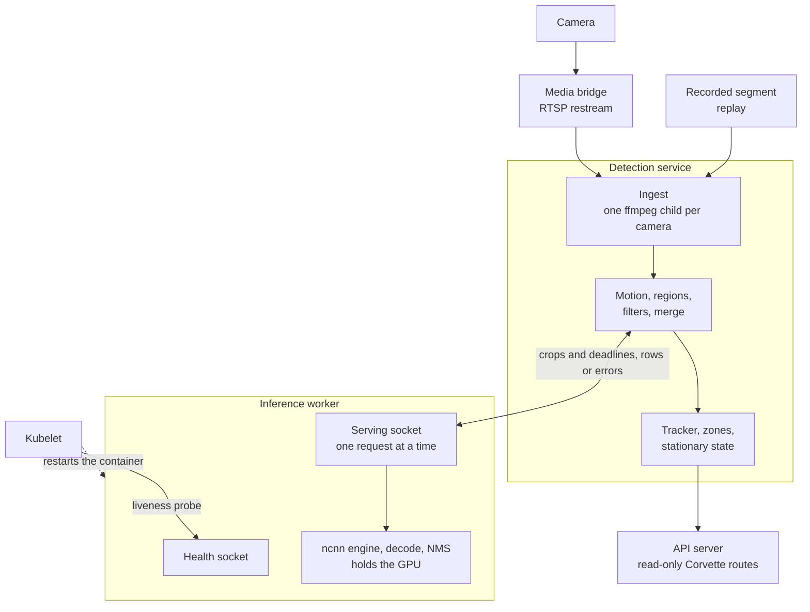
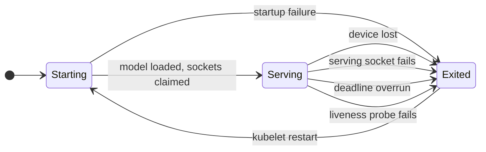

# Detection

Corvette detects objects with two cooperating processes: an inference worker
that owns the GPU, and a detection service that owns everything stateful. This
document states the boundary between them, who owns what, the rules both sides
keep and the decisions behind that shape.

Every value (sizes, thresholds, timeouts, exit codes, flags) has one owner in
the code or its tests. This document names the owner and leaves the value
there; [Where each fact lives](#where-each-fact-lives) lists them.

This document describes the target. Per-component status lives in
[issue #6][detection-issue] and the [roadmap][roadmap]. The wider system is in
[Architecture](architecture.md).

## Shape

**The inference worker** is one process. It owns the ncnn Vulkan device, loads
the model once, runs one request at a time, decodes the network output (score
gate, box conversion, non-maximum suppression) and returns rows. Its state is
the loaded model and its sockets, so a restart costs the request in flight. It
ends itself on an engine failure, which it reports as a lost device, or when a
request outlives its deadline, because ncnn's Vulkan instance is process-wide
and a new device needs a new process.

**The detection service** owns the camera-facing and stateful work: one ffmpeg
child per camera, motion, regions, filters and merge, the tracker, zones and
stationary state. One code path reads a live restream or a recorded segment,
and the pipeline's clock is the frame timestamp, so a replay follows the same
rules as a live run. The service publishes tracked objects and its own health
as read-only Corvette routes that the API server relays. Their shapes are
recorded in [API and media contracts](api-contracts.md) when the routes are
specified.

## The socket boundary

The worker serves two local sockets.

- **Serving socket.** The detection service sends requests here. The worker
  takes one connection at a time and one request at a time.
- **Health socket.** A separate listener on its own thread answers health
  requests, so health answers arrive promptly whatever the serving connection
  is doing.

The bytes on both sockets are defined once, in `corvette-detect-proto`: a
versioned header, then a body. Requests ask for decoded rows (production), the
raw network output (parity measurement) or health, and each carries its caller's
deadline. A failure travels as a typed error reply. The crate holds pure encode
and decode functions; the worker and its client own the read and write loops.

The detection service starts without waiting for the worker and reports
`inference-unavailable` until the worker answers.

## Worker lifecycle

- **Startup order.** Device, model, serving socket, health socket, then a ready
  line. An answering health socket therefore means the model is loaded.
- **Socket files.** Any socket file at a socket path is replaced, so a file left
  by an earlier run does not block a restart. Any other kind of file at a socket
  path stops startup and stays untouched.
- **Fatal paths.** An engine failure (reported as a lost device) and a deadline
  overrun each end the process with their own exit code. One function, `fatal`,
  takes the exit action as a `Terminator`; the process-exit implementation of
  that trait is the only call of process exit. The crate's tests record the code
  through a recording `Terminator`, and the end-to-end tests of the binary
  observe the real exit. Every other end of the process returns a status from
  `main`: help, probe, usage, startup failure and a failed serving socket.
- **Deadlines.** Each inference request carries a deadline. The operator-set cap
  bounds it, and a watchdog thread enforces the result. A health request carries
  a deadline field that the worker does not use.
- **Liveness.** The worker binary has a probe mode that sends a health request
  to the health socket and exits with a status. The container's liveness probe
  runs it. A hung engine call ends in the watchdog's exit, so health stays a
  plain "is it answering" check.
- **Restart.** The worker is its container's main process, and the kubelet
  restarts the container after an exit or a failed probe.

## Rules both sides keep

| Rule | Enforced by |
|---|---|
| `unsafe` code lives in `ncnn-sys` and `corvette-ncnn`; every other detection crate forbids it | the compiler: `#![forbid(unsafe_code)]` in each crate root |
| ncnn runs in full precision; the half-precision options are set in one function | `configure_options` in `corvette-ncnn`; `fixture_loads_with_declared_blobs_and_fp32_options` reads the options back |
| The protocol's sizes match the decoder's | a compile-time assertion in the worker's crate root |
| A malformed frame is refused and never served as a request: an unknown version, an unknown kind byte or an oversize length from its header alone, before any body is allocated; a wrong length or a wrong direction by the decoder, after a body no larger than the maximum is read; a frame cut short on the wire ends the connection | `corvette-detect-proto` tests (`malformed.rs`) |
| A failed inference is an error value on every path, and no path turns it into an empty detection list | worker tests, for example `an_engine_failure_answers_device_lost_and_ends_the_server` |
| One call of process exit serves every fatal path; ordinary exits return a status from `main` | review of each change that touches `fatal.rs` or adds a `process::exit` |
| The protocol and decoder crates read no clock and perform no I/O | review of each change to those crates |

The checks named are those of the crates that exist. A rule that binds the
detection service gains its check when that crate is written. A rule enforced
by review is a candidate for a mechanical check; the strongest form of each rule
is the compiler or a test.

## Decisions of record

Adopted 2026-11-08 at the design gate for issue #6, under the human's
delegation.

- **Process split.** The worker is its own container and the kubelet is its
  supervisor. A restart replaces the process and so the Vulkan instance, the
  GPU stack stays in the worker's image, and supervision is the kubelet's
  alone. The split moves to one container with an in-service supervisor
  only if the kubelet's restart back-off proves too slow in a test window.
- **Detection configuration.** Corvette owns its detection configuration file.
  A converter seeds it once from a snapshot of the current backing's resolved
  configuration (Frigate), and the file is Corvette's from then on. Comparison
  runs then test the code, and a transcription error cannot pass for a
  detection difference.
- **Equivalence is behavioural.** The pipeline keeps the stages and their order
  and takes constants from the current backing's source. Agreement is judged at
  the level of events, replayed from recorded sub-stream footage against the
  events the current backing produced for the same hours. The first comparison
  produces the numbers and the human sets the thresholds from them.
- **Public surface.** The detection service serves read-only routes on a local
  socket, and the API server relays them under `/corvette/api/v1/`. The API
  server stays the single public door.

## Open

- **Where ffmpeg decodes.** The pod's GPU claim sits on one container, so GPU
  decode would move the ffmpeg children into the worker's container and change
  the process split. The CPU-decode measurement that settles it is tracked in
  [issue #6][detection-issue].

## Where each fact lives

| Fact | Owner |
|---|---|
| Frame layout, kinds, error codes, size limits | `corvette-detect-proto` (crate root constants, `header.rs`, `request.rs`, `reply.rs`) and its tests |
| Model input geometry | `corvette-yolo` (crate root constants) |
| Model output geometry, score gate, NMS threshold, maximum rows | `corvette-yolo` (`decode.rs` constants) |
| Fatal reasons and their exit codes | `FatalReason` and the `EXIT_*` constants in `corvette-detect-worker/src/fatal.rs` |
| Flags, probe mode, startup and usage exit codes | the `USAGE` text and the `EXIT_*` constants in `corvette-detect-worker/src/main.rs`; `tests/cli.rs` checks the behaviour |
| Request deadline rule and cap | `serve` in `corvette-detect-worker/src/serve.rs` and its deadline tests |
| Health listener behaviour | `serve_health` in `corvette-detect-worker/src/health.rs` |
| ncnn option settings | `configure_options` in `corvette-ncnn/src/net.rs` |
| Route shapes | [API and media contracts](api-contracts.md), once the routes are specified |
| Status and open work | [issue #6][detection-issue] |

## Changing this document

Change it when a boundary, a rule or a decision changes, with the human's
approval for a decision. A changed value changes the code and its tests, and
this document keeps pointing at the owner. When a rule gains a compiler check
or a test, update its row in [Rules both sides keep](#rules-both-sides-keep).

[detection-issue]: https://github.com/cvandesande/corvette/issues/6
[roadmap]: https://github.com/cvandesande/corvette/issues/1
